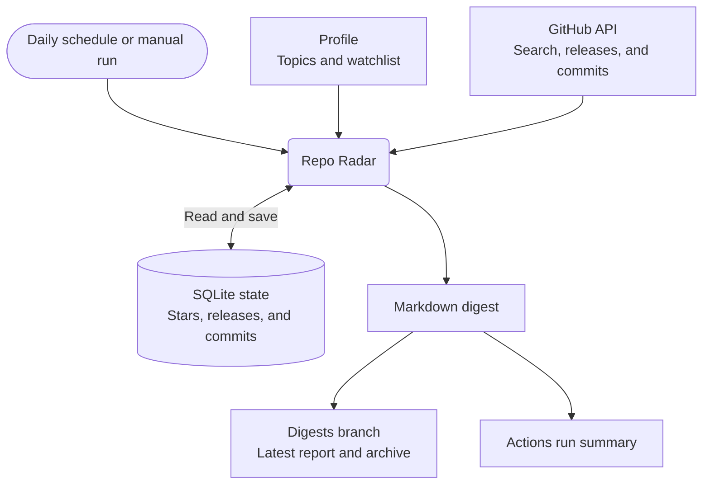

# Repo Radar

Find public GitHub projects that fit your interests and see what changed in the projects you already follow. Repo Radar turns both into a Markdown digest with links back to the source.

[](https://github.com/OmElMon/Repo-Radar/actions/workflows/daily-digest.yml) · [MIT license](LICENSE) · Python 3.9+

**[Read the latest digest](https://github.com/OmElMon/Repo-Radar/blob/digests/README.md)** · **[Browse the archive](https://github.com/OmElMon/Repo-Radar/tree/digests/archive)**

## Example digest

This excerpt from the November 17, 2026 run shows one discovery and one watchlist update. [Read the full archived digest](https://github.com/OmElMon/Repo-Radar/blob/digests/archive/2026-11-17/44160671138-1.md)

> **Discover** · [haydenschmitty/floorplan](https://github.com/haydenschmitty/floorplan)
>
> See how your app actually fits together. An interactive, plain-English map of your codebase, drawn by Claude or Codex.
>
> - **Why it surfaced** — matches developer-tools, created within 30 days.
> - **Community** — 4,719 stars · 387 forks.
> - **Language and license** — JavaScript · MIT.
> - **Activity** — created 2026-10-27 · last push 2026-11-16.
> - **Momentum** — collecting a baseline for a later UTC-day comparison.
> - **Explore** — [README](https://github.com/haydenschmitty/floorplan#readme) · [Releases](https://github.com/haydenschmitty/floorplan/releases) · [Contribution opportunities](https://github.com/haydenschmitty/floorplan/issues?q=is%3Aissue%20is%3Aopen%20label%3A%22good%20first%20issue%22).

> **Watchlist** · [astral-sh/ruff](https://github.com/astral-sh/ruff)
>
> - [13 new commits](https://github.com/astral-sh/ruff/compare/8a6a9492d0bc897ebb455fc1ab6916fb34e7b55a...c17364ba1091c85152842f806dbddc1731a089ea) on **main**.
> - [`4228f4c`](https://github.com/astral-sh/ruff/commit/4228f4c2168d50dc60df1aec705a1438c75a4888) \[ty\] Update imports when renaming Python package folders (\#30084)
> - File changes returned by GitHub — 57 modified.

## What you’ll find

| Discover projects | Follow releases and commits |
| --- | --- |
| Pick GitHub topics that matter to you. The digest shows matching projects with recent pushes, explains why they matched, and reports star growth once it has a baseline. | Add repositories you use. The digest links to new releases, highlights excerpts from their notes, and shows commits and added files on the default branch. |

The discovery feed gives both emerging and established projects a spot when both are available. Rankings use topic matches, stars, forks, and star growth observed across runs.

Each discovery includes the full repository description, the matching signals, language, license, creation date, last push, and links to its README, releases, and good first issues. Release excerpts keep section headings and multiline details so you can see the context behind an update.

## How the daily digest is made



## Run it locally

You’ll need **Python 3.9+**, Git, and an internet connection. Repo Radar uses the Python standard library.

```sh
git clone https://github.com/OmElMon/Repo-Radar.git
cd Repo-Radar
cp profile.example.json profile.json
python3 repo_radar.py --profile profile.json
```

Edit `profile.json` to choose GitHub topics and repos. You can use either list on its own.

```json
{
  "topics": ["python", "developer-tools"],
  "watch": ["astral-sh/ruff", "BurntSushi/ripgrep"]
}
```

Save a report with `python3 repo_radar.py --profile profile.json > digest.md`. Use `--limit 5` to show up to five discoveries. Set the optional `GITHUB_TOKEN` environment variable if you need higher API limits.

The first run records a baseline and shows the latest fetched release and current commit for each watched repository. Use the same profile and keep its `profile.state.sqlite3` file between runs to track changes. Use `--state` to choose another location, and keep one database per profile.

## Get a daily digest on GitHub

The [Daily digest workflow](.github/workflows/daily-digest.yml) runs at **9:17 a.m. Eastern**. Open the [latest digest](https://github.com/OmElMon/Repo-Radar/blob/digests/README.md), browse earlier reports by UTC date in the [archive](https://github.com/OmElMon/Repo-Radar/tree/digests/archive), or read a run’s summary from the [Actions tab](https://github.com/OmElMon/Repo-Radar/actions/workflows/daily-digest.yml).

To run a feed for your own interests:

1. Fork the repository and edit [the daily profile](.github/digest-profile.json) in your fork. Its topics and watchlist are public in a public fork.
2. Enable Actions in your fork, open **Daily digest**, and select **Run workflow** to create the first report.
3. Open the `digests` branch in your fork. Its README shows the latest report and its `archive/` folder holds earlier runs.

The workflow saves its SQLite state on the `digests` branch so the next run can measure star growth and pick up where it left off. It uses GitHub’s built-in workflow token. GitHub can delay scheduled runs or pause schedules in public repositories after 60 days of inactivity. [GitHub Actions schedule documentation](https://docs.github.com/en/actions/reference/workflows-and-actions/events-that-trigger-workflows#schedule)

## How checks work

- **Discovery** samples up to 30 results per GitHub Search query, using two queries per topic.
- **Watchlist** checks the first 100 GitHub Releases results, including published prereleases, and compares saved and current default-branch commits. Reports show up to five release-note excerpts of 600 characters each, five commit titles, a breakdown of returned file changes, and five added file paths, with a link to the full comparison.
- **API warnings** appear in the report. The run returns a failure status when checks are incomplete, and failed watchlist checks keep their previous baseline for the next run.

[Repository search API](https://docs.github.com/en/rest/search/search#search-repositories) · [Releases API](https://docs.github.com/en/rest/releases/releases#list-releases) · [Commit comparison API](https://docs.github.com/en/rest/commits/commits#compare-two-commits)

## Contributing

Open an [issue](https://github.com/OmElMon/Repo-Radar/issues) for a bug or feature idea, or send a pull request. For digest issues, include the command or Actions run, the relevant report excerpt, and what you expected to see. Leave credentials out of the example.

Run the digest regression tests from the project root with `python3 -m unittest discover -s tests -v`. These cover metadata in discovery reports, repeated-run growth comparisons, and release-note formatting.

Repo Radar is available under the [MIT license](LICENSE).
